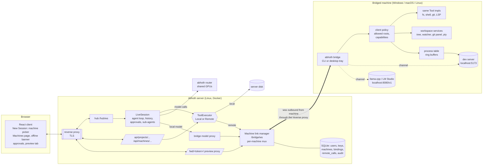

# Bridge mode: run server sessions against your own machines (design)

Status: **design only**, 2026-11-25. Build after the multi-user auth system lands (SQLite users,
per-user API keys, TOTP, audit log) and the user's go-ahead. Decision entry: PORTING.md **D136**.
The user's answers to the design questions (2026-11-25) are in
[section 0](#0-resolved-decisions-2026-11-25) and are reflected throughout.

A *bridge* links one of a user's machines (a laptop, a workstation with a GPU) to that user's
Abhoth server. In the server's web UI the user starts a new session and picks the machine it
runs against. The server keeps the session: the agent loop, the history, the model calls and
the rendering. The bridged machine only executes tools: files, search, shell, git, builds, the
file watcher for the web UI's file views, forwarded dev-server ports, and (optionally) local
models. It is like Claude Code's `/remote-control`, turned round: the server owns the session
and the machine is a remote pair of hands.

> Naming. "Bridge" already names the Claude Code / Codex *engine bridges* (D100-D103,
> `orca-webui/src/bridge.rs`, `engines::*`). The product and the CLI say "bridge"
> (`abhoth bridge`, "Bridge to server"), as decided. In code the new parts are called
> **machines** and **remote** (`orca-remote` crate, `machines` tables, `RemoteExecutor`) so the
> two never share an identifier.

---

## 0. Resolved decisions (2026-11-25)

Fixed by the user; the rest of this document is written to them.

| # | Topic | Decision | Where |
|---|---|---|---|
| R1 | Bridge credential | Pairing code in the web UI → a **dedicated per-machine bridge key** (`abk_...`). User API keys are refused on `/bridge/ws`; the bridge key works nowhere else | 5.1, 5.2 |
| R2 | Allowed folders | The machine's `bridge.json` is the **source of truth**. The web UI may **request** a folder; it is added only after the user **confirms on the machine** (tray popup or CLI prompt). A compromised server can ask, never add | 5.7, 12.3, 13.6 |
| R3 | Shell | **On by default** for allowed folders, with a per-folder switch to turn it off and the plain warning that commands can reach outside the allowed folders | 5.5, 12.4 |
| R4 | Port forwarding | **Same hostname, sandboxed preview** (CSP `sandbox`, opaque origin). Known breakage documented; a separate forward hostname is an optional later upgrade | 9.2 |
| R5 | Git credentials | The **machine's own**. The server's GitHub App / PAT tokens are **never** sent to a machine | 6.6, 12.3 |
| R6 | Local models | **Direct first** (phase 7), **then the router** with per-user upstreams (phase 8) | 10.2, 10.3 |
| R7 | Admins | Can see that a machine **exists** (name, owner, status, last seen) and **disable** it. No access to its files, sessions or calls; the **owner is notified** of a disable | 12.2, 13.2 |

## Contents

1. [Goals and non-goals](#1-goals-and-non-goals)
2. [Survey: what the code assumes today](#2-survey-what-the-code-assumes-today)
3. [Architecture](#3-architecture)
4. [Protocol](#4-protocol)
5. [Registration and identity](#5-registration-and-identity)
6. [The tool execution boundary](#6-the-tool-execution-boundary)
7. [Paths, OS differences and encodings](#7-paths-os-differences-and-encodings)
8. [Shell and process lifecycle](#8-shell-and-process-lifecycle)
9. [Port forwarding](#9-port-forwarding)
10. [Local models and the router](#10-local-models-and-the-router)
11. [Offline, pause and resume](#11-offline-pause-and-resume)
12. [Security model](#12-security-model)
13. [UI changes](#13-ui-changes)
14. [Data model](#14-data-model)
15. [Failure modes and testing](#15-failure-modes-and-testing)
16. [Phased build plan](#16-phased-build-plan)
17. [Questions: resolved and open](#17-questions-resolved-and-open)

---

## 1. Goals and non-goals

### Goals

- **Server-owned sessions on a user's machine.** The agent loop, session state, history,
  compaction, sub-agents, approvals and rendering stay on the server (architecture A). Model
  calls go out from the server (direct or through `abhoth router`).
- **The machine executes tools only:** file read/write/edit/search, shell and builds, git, the
  LSP, the folder watcher and file views of the web UI, the terminal panel, port forwarding and,
  if offered, its local model endpoints.
- **Survives a flaky link.** If the machine drops, the session pauses at the next tool call and
  shows "machine offline". Chat still works, without tools. Reconnecting resumes. No tool call is
  run twice, and a result that arrives after a reconnect is not lost.
- **Owner only.** A machine is visible and usable only by the user whose credentials registered
  it. Admins do **not** get access to other users' machines (they can see that one exists and
  disable it, not use it; R7, section 12.2).
- **The machine decides what it exposes.** A client-side config lists the allowed roots and the
  capabilities (shell, forwarding, models). The bridge refuses everything else itself, so a
  compromised server cannot read or write outside those roots through the file tools. The web UI
  can *request* another folder, but only a confirmation on the machine adds it (R2).
- **Two client forms:** a desktop tray toggle "Bridge to server" (`abhoth-desktop`) and a CLI,
  `abhoth bridge --server <url>`.
- **Handoff-ready.** v1 binds a session to one machine at creation, but the schema and the
  protocol carry a binding *epoch* so that "move to machine" can be added later.

### Non-goals (v1)

- Session handoff between machines (schema-ready only, section 14.4).
- A background service / daemon. The bridge runs while the CLI or desktop app runs (section
  5.6 notes where a service fits).
- Approvals on the machine. Approvals happen in the browser session only (decision 6).
- Sharing a machine with other users, or admin access to it.
- Engine bridges (Claude Code / Codex CLIs) running on the bridged machine. Native engine only;
  section 17, Q9.
- MCP servers on the bridged machine. Server-configured MCP servers keep running on the server;
  per-machine stdio MCP servers are a later extension of the same tool channel.
- Peer-to-peer or LAN-direct links. Everything goes through the server's public URL.
- A strong OS sandbox for shell commands. Enabling shell means "the server may run commands as
  you inside these folders, and commands can reach beyond them" (section 12.4). Optional
  OS sandboxing is a later hardening step.

---

## 2. Survey: what the code assumes today

This section decides the cost. In short: **the tool trait is a clean seam, but the pipeline
around it and the web UI's project services assume the tools' files are on the server's disk.**

### 2.1 The tool trait is a good boundary

`orca-abstractions::Tool` (`crates/orca-abstractions/src/lib.rs`) is object-safe and async:
`name`, `description`, `parameter_schema`, `risk_level`, `capabilities`,
`permission_arg_name`, `affected_file_paths(args, ctx)`, `prepare_arguments`,
`execute(args, ctx)` and `execute_streaming(args, ctx, on_output)`. `ToolContext` is only
`{ cwd: PathBuf }`. Tools are compiled in (D3) and registered in a `ToolRegistry`
(`orca-core::agent::registry`). There are exactly two execution call sites that matter:
`AgentSession::run_tool` (`agent/session.rs`) and the early read-only runs
(`agent/early_runs.rs`); `engines::print` and `engines::session_sink` call `execute` for the
engine bridges' host tools.

Because the tools are compiled into the one `abhoth` binary, **the bridge can run the very same
tool implementations** on the machine. Remote execution is "send name + args + cwd, run the
same `Tool` there, send the `ToolResult` back", not a reimplementation.

### 2.2 What assumes local disk around the trait

| Area | Where | Assumption | Bridge treatment |
|---|---|---|---|
| Path resolution | `orca_abstractions::full_path`, `ToolContext::full_path` | `#[cfg(windows)]` decides separators and absoluteness at **compile time**. A Linux server cannot resolve `C:\src\app` | Paths are resolved on the machine. Server-side code that needs a path gets a flavour-aware pure resolver (7.2) |
| Directory restriction | `session.rs::directory_restriction` | Lexical check on server paths | Moves into the workspace steps (6.3), runs on the machine |
| Read-before-edit | `check_read_before_edit`, `track_file_access` | `std::fs::metadata` mtimes, `files_read` map in `AgentSession` | Workspace steps on the machine; per-session state kept there |
| Checkpoints / undo | `session::checkpoint` (`CheckpointManager`), `tool_hooks::snapshot` | Copies files into `~/.abhoth/checkpoints` on the server | Kept on the machine (6.4) |
| Hooks, auto-formatter | `hooks::runner`, `hooks::formatter` | Spawn processes on the server with the project's files | Run on the machine as part of the call (6.3); they need `exec` |
| System prompt | `agent::system_prompt` (`PLATFORM`, `os_version_string`, `CWD`), `config::project_instructions::load_all` (ORCA.md / AGENTS.md / CLAUDE.md, `.git` / `.sln` project root) | Reads the server's OS and disk | A `prompt_context` RPC returns OS, shell, cwd and the instruction files (6.5) |
| Orchestration files | `orchestration::{brief_files, workflow, custom_agents, prompt_loader}` | `std::fs::read` of project files | Through the `Workspace` file API (6.2) |
| Process registries | `orca-tools-shell::process::PROCESSES`, `orca-tools-pi::jobs::SHARED`, `orca-tools-common::task_store::SHARED` | Process-wide statics | Shell/jobs registries live on the machine, keyed by session. `TaskStore` stays on the server (but see 12.6: it is a cross-user leak once there are several users) |
| LSP | `orca-tools-lsp::LspClientManager` | Spawns language servers locally | On the machine; counts as `exec` (language servers run project code) |
| Git tools | `orca-tools-git` | `git` / `gh` on the server's PATH | On the machine, with its own credentials (R5) |
| Image tools | `generate_image` / `edit_image` (`orca-tools-image::generate`) | Model call **and** `std::fs::write` of the result | Split: HTTP on the server, bytes written through `Workspace` |
| Sub-agents | `orchestration`, `seed_sub_agents` | In-process copies of the Lead session sharing its registry and ctx | Inherit the Lead's executor; machine-wide concurrency cap |
| Engines (Claude Code / Codex) | `engines::*` | Run a CLI in a local folder | Not supported on bridged sessions in v1 |

### 2.3 What assumes local disk in the web UI

`orca-webui` is a project-per-folder host. A *project* (`projects::manager::ProjectRuntime`) is a
server folder with its own `LiveSession`, `FolderWatcher`, `EditTracker`, git service,
worktrees, terminal and preview. "New session" in the client is the **Add project** dialog
(`client/src/features/projects/AddProjectDialog.tsx`) with a server-side folder browser
(`/api/fs/browse`). Everything below `/api/projects/{pid}/...` reads the disk directly:

| Feature | Module | Local operations |
|---|---|---|
| Tree, changes, file read/write | `files::service`, `projects::endpoints` | `std::fs` (13 sites) via `paths::FolderAccess` |
| Watcher | `files::watcher` (polls, D69) | `git status` + folder mtimes every 2-4 s |
| Edit markers | `files::edit_tracker` | in memory, fed by tool results |
| Raw files, attachments | `files::attachments` | reads; uploads saved to `<project>/.orca/attachments` |
| HTML preview | `files::preview` | serves files from the project folder under a signed token |
| Git panel | `git::{service, branches, worktrees}` | spawns `git`, injects server-held GitHub tokens |
| Terminal | `pty` (portable-pty) | a shell on the server in the project folder |
| Folder browser, clone | `projects::{browser, clone}` | server disk, `git clone` |

`paths::FolderAccess` ("the one gate between a path from the browser and the disk": `..`,
rooted and drive paths, NTFS streams, NULs and links leaving the root are rejected) is exactly
the check the bridge needs on the machine. It moves, with the file and git services, into a
crate both sides use (6.6).

### 2.4 What already fits

- **The hub protocol** (`orca-webui::hub`, D66): JSON over one websocket, numbered server
  messages, `ack`, a replay buffer and resume with `?resume=<id>&last=<n>` for a grace period.
  The bridge link reuses the idea (and code) for its control channel.
- **Approvals in the browser**: `native::PermissionBroker` already turns a permission `Ask` into
  a browser prompt (the native session runs on its own thread, D72). Remote calls use the same
  broker, which satisfies decision 6 with no new UI mechanism.
- **The audit log** (`orca-webui::audit`, JSON lines, `Caller`), which the auth work moves into
  SQLite with user ids.
- **`ChatBackend` / `OpenAiClient::with_router`** (D45) and `AgentClientProvider` (D50): a model
  endpoint can be swapped without touching the loop.
- **The desktop app** (`orca-cli::desktop`, D110/D113) has a tray with a menu (Show, Quit) and a
  user event loop; adding a checkable item is small.

### 2.5 Verdict

| Piece | Difficulty | Why |
|---|---|---|
| Executing a tool remotely | **Easy** | One trait, two call sites, same binary on both ends |
| The pipeline steps around execution | **Medium** | Snapshot, restriction, read-before-edit, formatter, hooks and file tracking are interleaved with host steps in `AgentSession::execute_tool_call`; they must be extracted into one "workspace steps" function. Mechanical, but parity-sensitive (the cross-check covers it) |
| Paths across OSes | **Medium** | Compile-time `cfg(windows)` path logic; needs a runtime flavour on the server side |
| The web UI's project services | **Medium-large** | Many endpoints read the disk directly; they move behind a `ProjectBackend` with a local and a remote implementation |
| Protocol, resume, processes, forwarding | **Medium-large** | New code, but conventional |
| Local models | **Small** (direct) / **Medium** (through the router with per-user upstreams) | |

---

## 3. Architecture



ASCII summary of one tool call:

```
browser ──SendPrompt──▶ hub ──▶ LiveSession turn ──▶ model (router) ──▶ tool call "edit_file"
  ▲                                     │
  │ events (streamed output,            ▼
  │  approvals, banner)          host steps: plan/sandbox policy, permission rules,
  │                              approval in browser if Ask, pre-hook decision
  │                                     │
  │                                     ▼  RemoteExecutor
  │                        rpc tool.exec {callId, epoch, tool, args, cwd, policy}
  │                                     │   (wss, through reverse proxy)
  │                                     ▼
  │                        abhoth bridge: policy gate (roots, caps)
  │                          workspace steps: restriction, read-before-edit,
  │                          checkpoint, execute same Tool, stamps, formatter
  │                                     │
  └──────── result {callId, ToolResult, affectedPaths, changedFolders} ◀──┘
```

### Crates

| Crate | New / changed | Contents |
|---|---|---|
| `orca-abstractions` | changed | `Placement` on `Tool`; `PathFlavor` + pure resolver; `ToolExecutor` trait and request/outcome types |
| `orca-core` | changed | `AgentSession` executes through `Arc<dyn ToolExecutor>`; `LocalExecutor`; workspace steps extracted (`agent::workspace_steps`) |
| `orca-workspace` | **new** (moved out of `orca-webui`) | `paths::FolderAccess`, `files::{service, watcher}`, `git::{service, branches, worktrees}` minus the HTTP layer; used by the server (local projects) and the bridge |
| `orca-remote` | **new** | Protocol types and framing, the mux, the client (`abhoth bridge`) and the server-side link manager + `RemoteExecutor` + `RemoteProjectBackend` |
| `orca-webui` | changed | `/bridge/ws`, `/api/machines`, `ProjectBackend` (local/remote), `/fwd/` proxy, offline state in snapshots |
| `orca-cli` | changed | `abhoth bridge` subcommand; desktop tray item |
| `orca-testkit` | changed | `fake-bridge` and a link-chaos proxy |
| `orca-router` | changed (later phase) | per-user private upstreams (10.3) |

---

## 4. Protocol

### 4.1 Transport

- **One outbound WebSocket over TLS** from the machine to `wss://<server>/bridge/ws`, through
  the existing reverse proxy (the hub already needs WebSocket upgrades there, so no proxy
  change). Outbound-only means no port opens on the user's machine and NAT/firewalls are no
  issue.
- **Why not HTTP/2 streams or gRPC:** reverse proxies commonly terminate HTTP/2 and speak
  HTTP/1.1 upstream (nginx does), which breaks long-lived bidirectional streams; WebSockets
  pass through every common proxy and Cloudflare-style tunnel, and axum + tokio-tungstenite are
  already pinned (D2). Multiplexing is done inside the socket (4.2).
- **Why not yamux/QUIC inside the socket:** yamux streams die with their transport, and we need
  application-level resume anyway (4.6); a small custom framing with credit-based flow control
  is simpler than adapting a mux library to survive reconnects. QUIC needs UDP through the proxy.
- TLS: rustls with native roots (tokio-tungstenite feature `rustls-tls-native-roots`, a new
  pinned feature, not a new crate family). `--insecure-localhost` only for `ws://127.0.0.1`
  development. Certificate pinning is optional (`--server-cert-sha256`).
- The upgrade request carries `Authorization: Bearer <bridge key>`,
  `X-Abhoth-Bridge-Proto: 1`, `X-Abhoth-Machine: <machine id>`. The browser-only checks
  (Origin, CSRF, cookies) do not apply on this path; the bridge key does not work anywhere else
  (12.2).

### 4.2 Framing and multiplexing

Binary WebSocket messages only. Every frame:

```
 0      1           5           9
 +------+-----------+-----------+------------------------
 | kind | channel   | seq       | payload ...
 | u8   | u32 BE    | u32 BE    |
 +------+-----------+-----------+------------------------
kind: 0 CTRL   JSON control message (channel 0 only)
      1 OPEN   open a channel: JSON {type, ...}            (either side)
      2 DATA   bytes for an open channel
      3 CREDIT u32 BE: more bytes the sender may send       (flow control)
      4 CLOSE  JSON {reason, code} half/full close, or RESET
seq:  per-direction counter for CTRL frames (resume); 0 for other kinds
```

Channel ids: odd numbers opened by the server, even by the bridge, 0 is control. A frame is at
most 256 KiB; larger payloads are split. Maximum 1024 open channels per link.

**Channel types** (the `type` in OPEN):

| Type | Opened by | Carries | Survives reconnect? |
|---|---|---|---|
| control (0) | implicit | RPC requests/responses, events, heartbeats | yes (resume, 4.6) |
| `proc.out` | bridge | stdout/stderr of a process or PTY, by process id and byte offset | re-attached by offset |
| `proc.in` | server | stdin / PTY input and resize | no (reopened) |
| `file.get` / `file.put` | server | file bodies over 512 KiB (raw view, uploads, attachments) | no (retried by the caller) |
| `tcp` | server | one forwarded TCP connection to an allowed local port | no (browser reconnects) |
| `model` | server | one HTTP request/response to an allowed local model endpoint | no (the loop's retry) |

Control messages (JSON in CTRL frames):

```jsonc
// RPC
{"t":"req","id":"r-1842","m":"tool.exec","p":{...}}
{"t":"res","id":"r-1842","ok":true,"r":{...}}            // or "ok":false,"err":{"code","msg"}
{"t":"cancel","id":"r-1842"}
// events (bridge -> server)
{"t":"ev","m":"files.changed","p":{"root":"r1","folders":["src"]}}
{"t":"ev","m":"proc.exit","p":{"pid":"p-7","code":0}}
// link
{"t":"hello",...} {"t":"welcome",...} {"t":"ping","ts":...} {"t":"pong","ts":...}
{"t":"ack","seq":912}
{"t":"bye","code":"revoked"|"replaced"|"shutdown"|"upgrade-required","msg":"..."}
```

RPC methods (server to bridge unless noted):

| Method | Purpose |
|---|---|
| `tool.exec` | run one tool call (6.3) |
| `tool.status` | states of call ids after a reconnect (4.6) |
| `prompt.context` | OS, shell, cwd, project root, instruction files (6.5) |
| `ws.fs.*` | `stat`, `list`, `tree`, `read`, `write`, `browse` for the web UI and `Workspace` |
| `ws.git.*` | the git panel's operations (status, diff, head, stage, commit, branches, worktrees, fetch/pull/push) |
| `ws.watch` | start/stop the folder poller for a root; changes come back as `files.changed` events |
| `proc.*` | `spawn`, `signal`, `kill_tree`, `list`, `attach` (offset), `pty.open`, `pty.resize` |
| `fwd.open` | check a port is allowed, then open a `tcp` channel |
| `model.list` | the machine's advertised local models (also in `hello`) |
| `checkpoint.*` | `list`, `diff`, `restore` for the undo UI |
| `session.end` | end-of-session cleanup (8.4) |
| `policy.get` | the server can read, never set, the machine's policy |
| `policy.requestRoot` | ask the machine to allow a folder; answered only after a local confirmation (5.7) |
| `policy.removeRoot` | narrow the policy (no confirmation needed) |

### 4.3 Versioning

- `hello` (bridge to server, first frame):
  `{"t":"hello","proto":[1,1],"bridge":"0.17.0","machine":"m_01J...","os":"windows",
  "arch":"x86_64","osVersion":"Microsoft Windows NT 10.0.26100.0","features":["pty","fwd","models"],
  "caps":{...},"roots":[...],"models":[...],"resume":{"link":"l_...","lastSeq":912}}`.
- `welcome` (server): `{"proto":1,"server":"0.17.0","link":"l_...","resumed":true,"lastSeq":877,
  "heartbeat":15}`.
- `proto` is a single integer major, negotiated as the highest both support. Additive changes
  use `features` strings; unknown fields are ignored on both sides; unknown RPC methods answer
  `{"code":"unsupported"}`. A server that cannot speak any of the bridge's majors sends
  `bye upgrade-required` and the client shows "update Abhoth on this machine".
- The tool manifest (6.1) is versioned by the binary's version + a hash of the manifest, so
  a bridge running a different Abhoth version still works: the server uses the bridge's own
  tool descriptions and schemas.

### 4.4 Heartbeats

- App-level `ping`/`pong` on the control channel every 15 s (both directions; RTT is shown on
  the machines page). Reverse proxies with a 60 s idle timeout stay happy.
- A link with no frame for 45 s is dead: the server marks the machine **reconnecting**; the
  bridge closes and reconnects.
- After a further grace of 60 s (configurable) without a resume, the machine is **offline**:
  sessions bound to it pause at their next remote call (section 11). "Reconnecting" already
  shows a soft banner; "offline" shows the full one.

### 4.5 Backpressure

- **Data channels:** credit-based, like SSH windows. Each side grants 256 KiB per channel at
  OPEN and sends CREDIT as the consumer drains. A sender never exceeds its credit, so one
  chatty process cannot starve the control channel or the other channels.
- **Process output:** the bridge always reads the child's pipes (never blocks the child) into a
  per-process ring buffer (default 4 MiB, spill to a temp file up to 64 MiB, then drop the
  oldest with a marker). The `proc.out` channel streams from the buffer as credit allows. This
  is also what makes output survive a disconnect (8.3).
- **Control channel:** not flow-controlled, but bounded: at most 64 RPCs in flight per link
  (the server queues beyond that, per session fairly), events coalesced (`files.changed` merges
  folders within 250 ms), and a CTRL frame over 1 MiB is a protocol error.
- **WebSocket writes** go through one writer task per link with a priority queue: CTRL first,
  then DATA round-robin across channels.

### 4.6 Reconnect and resume

Two layers:

1. **Link resume (control channel).** Exactly the hub's scheme (D66): each side numbers its CTRL
   frames (`seq`), acks the peer's, and keeps unacked frames in a replay buffer (max 5000 frames
   or 8 MiB). A reconnecting bridge sends `resume: {link, lastSeq}`; if the server still has the
   link (grace 10 min, longer than the offline threshold), both sides replay everything after
   the peer's last seq and `welcome.resumed = true`. RPCs and results in flight across the drop
   are delivered exactly once. If the replay buffer overflowed or the server restarted,
   `resumed = false` and layer 2 applies.
2. **Call reconciliation (no link resume).** The server's `remote_calls` journal (14.3) knows
   which call ids it sent and has no result for. After a fresh link it sends
   `tool.status {ids:[...]}`. The bridge's own call journal (on disk, 6.3) answers per id:
   - `done` + the stored result (the server applies it as if it had just arrived);
   - `running` (the result comes later as a normal `res`, re-addressed by call id);
   - `unknown` (never received). The server may re-send it **only** if the session is still
     waiting on it and the user has not moved on (11.2); otherwise it records "not run".
   Processes are re-attached with `proc.attach {pid, offset}`.

A server restart loses in-memory link state but not the journal; the machine reconnects and
layer 2 runs. A bridge restart kills its children (8.4) and loses running calls; their ids come
back `unknown` (if never started) or `done`/`lost` from the on-disk journal.

Reconnect backoff on the bridge: 1 s, doubling to 30 s, with ±20 % jitter; immediately on a
network-change signal where the OS gives one. `bye replaced` (another connection for the same
machine) and `bye revoked` stop reconnecting.

---

## 5. Registration and identity

### 5.1 Bridge key vs the user's API key

**Recommendation: a dedicated, scoped bridge key per machine**, not the user's general API key.

| | User API key | Bridge key (recommended) |
|---|---|---|
| What a leak gives | the user's whole account API | "be this machine" (connect and answer RPCs); cannot start sessions, read history or call any `/api` route |
| Revocation | breaks every client of the user | revokes one machine |
| Audit | "user X" | "user X via machine Y" |
| Server-side check | general Bearer middleware | only `/bridge/ws` accepts it; every other route rejects the `abk_` prefix |

Format: `abk_<keyId>_<secret>` (secret: 32 random bytes, base32). Stored as SHA-256 of the
secret (a high-entropy secret needs no Argon2) plus the 8-char prefix for display. One key per
machine; rotating issues a new key and revokes the old one after the bridge confirms it saved it.

### 5.2 Pairing (how a machine gets its key)

Device-code style, so no long-lived user secret is ever typed into the bridge:

```
$ abhoth bridge --server https://abhoth.example.com
  This machine is not paired yet.
  Open https://abhoth.example.com/machines/pair and enter: KXQF-7HDM
  (or scan the QR code below)  ... waiting (expires in 10 min)
```

1. The bridge calls `POST /api/bridge/pair/start` (unauthenticated, rate-limited per IP) with
   its proposed name, OS and capabilities summary; gets a user code and a poll token.
2. The user opens the link in a signed-in browser (TOTP already done by the login), sees what
   the machine asks for (name, OS, roots, shell/forward/models) and clicks **Pair**. Pairing is a
   sensitive action: it requires a fresh sign-in (step-up) within the last 10 minutes.
3. The bridge's poll returns `{machineId, key}` once. The pairing is recorded in the audit log.

Headless alternatives: `--key-file <path>` or `ABHOTH_BRIDGE_KEY` with a key created on the
machines page ("Add machine manually", shown once). The desktop app shows the same code page in
its own window.

The key is saved in `~/.abhoth/bridge/credentials.json` (user-only ACL / mode 0600) together with
the server URL and machine id. OS keychains (Windows Credential Manager, macOS Keychain, Secret
Service) are a later improvement (new dependency; Q8).

### 5.3 Machine identity

- `machine_id`: a ULID assigned by the server at pairing (`m_01J...`); the bridge stores it.
  Name: user-editable, defaults to the hostname. Hostname, OS, arch and bridge version are
  *reported* data, shown but never trusted for decisions.
- One live link per machine. A second connection with the same key replaces the first
  (`bye replaced` to the old one) — this handles a laptop that woke up with a half-dead socket.
- The same physical machine can be paired twice (two keys, two machine records); nothing breaks.

### 5.4 Capability advertisement

The `hello` carries the machine's policy as the **machine** sees it, read from its client-side
config. The server stores it, shows it, and enforces it again (defence in depth), but the
machine is the authority.

```jsonc
"caps": {
  "fs": true,                    // always; read/write inside roots, subject to per-root "write"
  "exec": true,                  // shell, builds, processes, hooks, formatter, LSP
  "pty": true,                   // the terminal panel
  "forward": {"ports": ["3000-3999", "5173", "8000-8999"]},  // loopback ports only
  "models": true,
  "maxConcurrentCalls": 8
},
"roots": [
  {"id": "r1", "path": "C:\\Users\\<you>\\src", "label": "src", "write": true, "exec": true},
  {"id": "r2", "path": "D:\\datasets", "label": "datasets", "write": false, "exec": false}
],
"pendingRootRequests": 0,
"models": [
  {"id": "local/qwen3-coder-30b", "endpoint": "http://127.0.0.1:8080/v1", "ctx": 65536, "lanes": 1}
]
```

### 5.5 Client-side config

`~/.abhoth/bridge/bridge.json` (JSON like the rest of the state home; written by the desktop
settings page or by hand; `abhoth bridge init` creates a commented example):

```jsonc
{
  "server": "https://abhoth.example.com",
  "name": "workstation",
  "roots": [
    {"path": "C:\\Users\\<you>\\src"},                      // write and exec default to true
    {"path": "D:\\datasets", "write": false, "exec": false}   // read-only, no shell
  ],
  "exec": true,                    // machine-wide master switch; default true (R3)
  "pty": true,
  "rootRequests": "prompt",        // "prompt" (default) | "off": refuse folder requests
  "forward": {"ports": ["5173", "3000-3999"]},   // empty = no forwarding
  "models": [{"id": "local/qwen3-coder-30b", "endpoint": "http://127.0.0.1:8080/v1"}],
  "processes": {"orphanGraceMinutes": 30, "maxOutputMiB": 64},
  "denyGlobs": ["**/.env", "**/*.pem", "**/id_*"]   // never read or written, even inside roots
}
```

Defaults: **no roots** (the bridge refuses to start without at least one; the desktop app's
first run asks for one), per root `write: true` and **`exec: true`** (R3), `pty` on, no
forwarding, no models, folder requests prompt. Turning a root's `exec` off (or the master switch)
removes the shell, process, hook, formatter and LSP tools for sessions in that root. The first
run and the pairing page show the warning from 12.4 once, in plain words. The CLI can add a root
for one run: `abhoth bridge --root .` (`--no-exec` for a read/write root without shell; shown in
the status line, not saved unless `--save`).
Changes to the file take effect on the next connect; the bridge sends a fresh `hello` with
`{"t":"policy","caps":...}` when the file changes while connected.

### 5.6 Where a background service would fit (not in v1)

`abhoth bridge` is written as a library loop (`orca_remote::client::run(config, shutdown)`)
so a service wrapper is thin: a Windows service / per-user scheduled task, a systemd **user**
unit, a launchd agent. A service would (a) let processes outlive the desktop app, (b) move the
credential to the OS store, and (c) need a local control socket for the tray toggle to talk to
it. The protocol, data model and policy file do not change.

### 5.7 Folder requests (R2)

The web UI may ask the machine to allow another folder; only the person at the machine can
grant it.

```
browser ── "Request folder" (path, write, exec, reason) ──▶ server
server  ── rpc policy.requestRoot {requestId, path, write, exec, requestedBy, reason} ──▶ bridge
bridge: canonicalise the path; refuse outright if it is a system root, a drive or filesystem
        root, the user's home folder itself, inside the bridge's own state folder, or matches
        denyGlobs; otherwise show a LOCAL prompt (tray dialog / CLI prompt)
user at the machine: Allow (optionally untick write / shell) | Deny | ignore (expires in 5 min)
bridge: on Allow, append the root to bridge.json (atomic write), then send
        {"t":"policy", ...} and answer {requestId, outcome: allowed|denied|expired|refused, root}
server: updates the machine's policy; the web UI shows the outcome
```

Rules:

- **Only a local action adds a root.** There is no RPC that writes `bridge.json` without the
  prompt, and the prompt cannot be answered from the server: it is a native dialog or a TTY
  prompt, not a web page. The machine's grant is what is enforced.
- **What is shown locally is what the machine resolved**: the canonical path (symlinks and
  junctions followed), the requested rights (write, shell), the requesting user and server, and
  the reason text (marked as coming from the server, length-capped, control characters
  stripped). The user can narrow the grant (untick write or shell), never widen it beyond the
  request.
- **Only the owner's web session can request**, from the UI. The model has no tool for it, so a
  prompt-injected agent cannot ask for folders (it can only suggest that the user does).
- **Noise limits** against a compromised server spamming prompts: one pending request per
  machine, 5 per hour, a 5-minute expiry, and after 3 denials in a row requests are muted until
  the user turns them on again (tray, or `abhoth bridge requests on`).
- **Nobody to ask** (CLI without a TTY, `--quiet`, `rootRequests: "off"`): refused with "can't
  confirm on this machine".
- **Removing** a root from the web UI needs no confirmation (it only narrows access). The bridge
  applies it to `bridge.json`, kills processes started in it, and it is audited.
- Every request and its outcome goes to the server's audit log and the bridge's local log.

---

## 6. The tool execution boundary

### 6.1 Placement and the manifest

Each tool declares where it runs:

```rust
// orca-abstractions
pub enum Placement {
    /// Runs on the server: think, print, task_list, ask_user, spawn_agent(s), report_progress,
    /// web_fetch, web_search, MCP proxies, lead_mode, Pi subagent/progress.
    Host,
    /// Runs where the session's files are (the default): fs, search, shell, git, github, archive,
    /// crop/resize_image, lsp, env, network diagnostics, Pi read/write/edit/bash/ls/find/grep/job.
    Workspace,
    /// Server work plus workspace file I/O through `Workspace` (generate_image, edit_image).
    Split,
}

pub trait Tool {
    // ... unchanged ...
    fn placement(&self) -> Placement { Placement::Workspace }
}
```

On connect the bridge sends a **tool manifest**: for each `Workspace`/`Split` tool its name,
description, parameter schema, risk, capabilities, permission arg and render hints, as built
**on that machine**. The server builds the session's registry from its own `Host` tools plus
`RemoteTool` proxies built from the manifest. This matters because several tools describe
themselves per OS at compile time (the shell tool's description and default shell, path
examples); a Linux server would otherwise advertise bash to a Windows machine.
`prepare_arguments` stays pure and runs on the server using the server's own instance of the
same tool (the Pi tools' argument validation), and only when the manifest hash matches the
server's; otherwise the bridge does it as part of `tool.exec`.

Tools a machine's policy disables (e.g. `exec: off` removes `bash`, the process tools, Pi
`bash`/`job`, LSP and the formatter) are **not advertised** to the model at all, so the model
does not try them and the system prompt says so.

### 6.2 The executor trait

```rust
// orca-abstractions (types) — implemented in orca-core (Local) and orca-remote (Remote)
#[async_trait]
pub trait ToolExecutor: Send + Sync {
    fn target(&self) -> &ExecTarget;            // Local | Machine { id, flavor, epoch }
    fn availability(&self) -> Availability;     // Online | Reconnecting | Offline
    async fn wait_online(&self, cancel: &CancelToken) -> Result<(), Offline>;

    /// One workspace tool call, including the workspace steps (6.3).
    async fn execute(&self, req: ExecRequest, out: &dyn OutputSink) -> ExecOutcome;

    /// File access for host code (prompt context, brief files, workflows, split tools).
    fn workspace(&self) -> &dyn Workspace;
}

pub struct ExecRequest {
    pub call_id: CallId,          // ULID, unique per session
    pub session_id: String,
    pub tool: String,
    pub args: Value,
    pub cwd: WorkPath,            // the session's cwd as a string + flavor
    pub policy: StepPolicy,       // checkpoint, read_before_edit, allowed_directory,
                                  // format, hooks, approved_outside_project
    pub deadline: Option<Duration>,
}

pub struct ExecOutcome {
    pub result: ToolResult,              // what the model sees (before host truncation)
    pub affected_paths: Vec<String>,     // resolved on the machine (files_modified, markers)
    pub new_cwd: Option<WorkPath>,       // `cd`
    pub needs_approval: Option<String>,  // outside the project but inside the roots (12.5)
    pub changed_folders: Vec<String>,    // for the file views, without waiting for the poller
}

#[async_trait]
pub trait Workspace: Send + Sync {
    async fn read(&self, path: &WorkPath, max: u64) -> io::Result<Vec<u8>>;
    async fn write(&self, path: &WorkPath, bytes: &[u8]) -> io::Result<()>;
    async fn stat(&self, path: &WorkPath) -> io::Result<Option<FileStamp>>;
    async fn list(&self, dir: &WorkPath) -> io::Result<Vec<DirEntry>>;
}
```

`ToolContext` does **not** change: on the bridge, tools still get a native `ToolContext { cwd:
PathBuf }`, so none of the ~70 tool implementations change. Only the server's session stops
holding a native path for remote sessions (`WorkPath` instead).

### 6.3 Splitting `AgentSession::execute_tool_call` into host steps and workspace steps

Today's pipeline (`AgentSession::execute_tool_call` and `run_tool` in `agent/session.rs`) becomes:

| Step | Today | After | Runs on |
|---|---|---|---|
| resolve tool, `prepare_arguments`, validate | host | host | server |
| input size, plan / sandbox / orchestrator policies (D11) | host | host | server |
| permission rules + browser approval (D12, `PermissionBroker`) | host | host | server |
| pre-hook | host | **workspace** (it runs a command with the project's files) | machine |
| checkpoint snapshot | host | workspace | machine |
| directory restriction | host | workspace (plus the machine's roots) | machine |
| read-before-edit check | host | workspace | machine |
| **execute** | host | workspace | machine |
| `cd` | host | outcome `new_cwd` | server state, resolved on machine |
| post-hook | host | workspace (background on the machine) | machine |
| track file access (mtimes) | host | workspace (per-session `files_read` on the machine) | machine |
| files_modified, mutation epoch, history record | host | host, from `affected_paths` | server |
| error prefix, truncation, VERBATIM | host | host | server |
| auto-format appendix | host | workspace (appended to the result there) | machine |

The workspace steps become one function in `orca-core::agent::workspace_steps` that both the
`LocalExecutor` (in-process, today's behaviour) and the bridge call, so local and remote cannot
drift. The cross-check (`orca-crosscheck`) runs against the local path and proves the refactor
changes nothing.

**The bridge's call journal.** Before executing, the bridge writes `{callId, sessionId, epoch,
tool, state: started}` to `~/.abhoth/bridge/journal/` (append-only, fsync'd, rotated daily, kept
7 days), and the result when done. A call id already in the journal is **never executed again**;
a repeat request returns the stored result or `running`. This gives exactly-once execution
across reconnects, and at-most-once across bridge crashes (a crash mid-call leaves `started`
without a result, reported as `lost`: "the machine restarted while this ran; its effects are
unknown").

**Idempotency classes** (used to decide what to do with `unknown`/`lost` calls, 11.2):

| Class | Tools | On `unknown` (never received) | On `lost` (crashed mid-run) |
|---|---|---|---|
| read-only | read_file, list_directory, glob, grep, git_status/diff/log, Pi read/ls/find/grep, lsp queries | re-send | re-send |
| idempotent write | write_file (whole content), mkdir, create_directory | re-send | re-send |
| non-idempotent | edit_file, multi_edit, apply_patch, delete/move/rename/copy, git commit/checkout/pull/push/stash, bash, background processes | re-send | **do not** re-run; tell the model the outcome is unknown |

### 6.4 Checkpoints and undo

Snapshots stay on the machine (`~/.abhoth/bridge/checkpoints/<session>/`, same format as
`CheckpointManager`). Reasons: file contents never leave the machine just for backup, restore
works with the files, and size is the machine's business. The server keeps no copy; the undo UI
calls `checkpoint.list/diff/restore`. Cleanup on `session.end` and by age (as
`cleanup_older_than`). Trade-off: undo for a bridged session needs the machine online, which
is the case for anything else you'd do with those files.

### 6.5 Prompt context

`prompt.context {cwd}` returns, computed on the machine by the existing code:
`platform` (the .NET-style `PLATFORM` string), `osVersion` (`os_version_string()`), `shell`,
`cwd`, `projectRoot` (`.git`/`.sln` walk) and the instruction files
(`project_instructions::load_all`: ORCA.md, AGENTS.md, CLAUDE.md, with their paths). The
server builds the system prompt from that instead of from its own disk. It is fetched at
session start, after a `cd`, and when `files.changed` touches one of those files. User memory
(`memory_manager`) stays on the server, per user.

### 6.6 The web UI's project services

`ProjectRuntime` gets a backend:

```rust
pub enum ProjectBackend {
    Local(LocalProject),                       // today's code, unchanged behaviour
    Remote { machine: MachineId, root: WorkPath, link: Arc<MachineLink> },
}
```

and the endpoints under `/api/projects/{pid}/...` call the backend instead of the disk:
tree/changes/file/raw/attachments → `ws.fs.*`; git panel → `ws.git.*`; watcher → `ws.watch`
events; terminal → `proc.pty.open` + channels; HTML preview → `ws.fs.read` streamed through the
existing signed-token route. The service code itself (`FolderAccess`, file service, poller,
git service) moves from `orca-webui` into **`orca-workspace`** so the bridge runs the same code
the server runs for local projects.

GitHub tokens held by the server (`git::tokens`) are **never** sent to a machine: fetch, pull,
push, clone and `gh` on a bridged project use the machine's own git credentials and credential
helper (R5). The git panel shows the machine's credential errors as they come.

### 6.7 Which tools need changes

| Tool / area | Change |
|---|---|
| all `Workspace` tools (fs, shell, git, github, archive, crop/resize, lsp, env, network, Pi) | none in the tool; `placement` default |
| `Host` tools (think, print, task_list, ask_user, agent tools, web, MCP proxy, lead_mode, Pi subagent/progress) | add `fn placement() -> Host` |
| `generate_image`, `edit_image` | `Split`: HTTP on the server, `ctx.workspace().write/read` for the image files |
| shell process registry, Pi jobs | key by session id on the bridge (list/stop only see the session's own processes) |
| `TaskStore` | per session on the server (also needed for multi-user, 12.6) |
| LSP manager | one manager per session on the bridge, closed on `session.end` |
| `cd` (`META_SET_CWD`) | cwd change comes back as `WorkPath` |
| engines (`print`, `session_sink`) | not available on bridged sessions in v1 |

---

## 7. Paths, OS differences and encodings

### 7.1 The rule

**The machine resolves paths; the server treats remote paths as opaque strings with a flavour.**
Every path the server stores or displays for a bridged session is a `WorkPath { flavor, text }`
as the machine reported it (`C:\Users\<you>\src\app\main.rs` or `/home/<you>/src/app`).

### 7.2 The flavour-aware resolver (server side)

Some host code needs path logic without touching disk: permission patterns, "is this inside the
project" for display, files_modified de-duplication, edit markers keyed by path, relative paths
in the file views. A pure function in `orca-abstractions`:

```rust
pub enum PathFlavor { Windows, Posix }
pub fn full_path_flavored(flavor: PathFlavor, base: &str, path: &str) -> String;
pub fn is_within(flavor: PathFlavor, root: &str, path: &str) -> bool;
pub fn eq_paths(flavor: PathFlavor, a: &str, b: &str) -> bool;   // case-insensitive on Windows
```

It reproduces `full_path` (the .NET `GetFullPath` lexical rules) for either flavour at runtime,
tested on both CI OSes against the existing `full_path` with the native flavour. It is advisory
only: the machine's `FolderAccess` check is the one that counts.

### 7.3 Differences to handle

| Topic | Windows machine | Linux/macOS machine | Handling |
|---|---|---|---|
| Separator, roots | `\`, `C:\`, `\\server\share`, `\\?\` | `/` | Machine resolves; server compares via flavour; `strip_verbatim` on results (existing) |
| Case | insensitive (NTFS default; per-folder case sensitivity exists) | sensitive (macOS: usually insensitive) | Flavour sets the comparison; machine reports `caseSensitive` per root from a probe |
| Reserved names | `CON`, `NUL`, `COM1`, trailing dots/spaces, `:` streams | none | Rejected by `FolderAccess` on the machine (it already rejects streams) |
| Long paths | >260 chars need `\\?\` or the long-path setting | — | Rust std handles it; reported paths without the prefix |
| Symlinks / junctions | junctions, symlinks need privilege | symlinks | Canonicalised on the machine before the roots check |
| Shell | pwsh / powershell / cmd (as `pty::default_shell` picks) | `$SHELL` / bash | From the machine's manifest and prompt context |
| Line endings | CRLF files common | LF | Unchanged: tools already preserve existing endings, as on a local Windows run |
| Executable bit | none | `+x` | `ws.fs.write` keeps the mode of an existing file |
| Path encoding | UTF-16 (lone surrogates possible) | bytes (non-UTF-8 possible) | Protocol strings are UTF-8. A name that is not valid Unicode is listed with `lossy: true` and its raw bytes base64 in `raw`; tools refuse to write to it |
| File contents | bytes | bytes | Raw bytes in `file.get/put` channels or base64 under 512 KiB; text decoding happens in the tools on the machine (`decode_text`), exactly as locally |
| Time | FILETIME | timespec | mtimes as i64 nanoseconds since the Unix epoch, UTC |
| Env / home | `%USERPROFILE%` | `$HOME` | Never expanded by the server |

### 7.4 Session cwd

The session's cwd is a `WorkPath`. `cd` is resolved on the machine (it must exist and be inside a
root) and comes back in `new_cwd`. The PTY and processes start in the machine-resolved folder.

---

## 8. Shell and process lifecycle

### 8.1 What runs

`bash` (the OpenOrca shell tool, which runs cmd/pwsh on Windows as it does locally),
`start_background_process`, `get_process_output`, `stop_process`, `list_processes`, the Pi `bash`
and `job` tools, hooks, the formatter, LSP servers and the terminal panel. All need the machine's
`exec` capability and a root with `exec: true` as the working directory.

### 8.2 Process table on the bridge

The bridge owns a process table: `pid` (bridge-assigned `p-<n>`, not the OS pid), session id,
root, command, start time, state, exit code, and the output ring buffer (4.5). The existing
`orca-tools-shell::process` registry is reused but keyed by session. Kill is always a tree kill:
a Job Object on Windows (`taskkill /T /F` fallback, as today), a process group (`setsid` +
`killpg`) on Unix.

### 8.3 Streaming, cancel, kill

- Foreground `bash`: output lines stream as `proc.out` data while the call runs; the server feeds
  them to `observer.on_tool_output` (the web UI's live tool output). The final `ToolResult` is the
  tool's own (truncated by the tool as today).
- Cancel (the browser's Stop, or the turn being cancelled) sends `cancel {id}` for the RPC; the
  bridge cancels the tool future, which kills the process tree, then answers with the tool's
  cancelled result.
- Timeouts: the pipeline's tool timeout (`TOOL_EXECUTION_TIMEOUT_SECONDS`) is enforced on the
  **machine** (deadline in `ExecRequest`), so a slow link does not eat into a build's time; the
  server adds a margin before it gives up waiting.
- Background processes and dev servers stream into their ring buffer; `get_process_output`
  reads from it by offset; the web UI can attach a live view.

### 8.4 Lifetime

| Event | Foreground call | Background processes / dev servers | Port forwards |
|---|---|---|---|
| Link drops | keeps running; result journaled | keep running, output buffered | channels close; the forward record stays |
| Machine **offline** past `orphanGraceMinutes` (default 30) | finishes, result journaled | killed (tree), noted in the journal | closed |
| Link back within the grace | result delivered (4.6) | re-attached by offset | browser reconnects |
| Session **paused** (offline) | — | as "link drops" | as "link drops" |
| Session **ended / deleted** | cancelled | killed | closed |
| Session idle (no turn) | — | keep running (dev servers are the point) | open |
| Bridge stopped (Ctrl+C, tray toggle off, app quit) | cancelled | killed (asked to confirm on the tray if any run) | closed |
| Bridge crash | — | killed by the OS with the Job Object / group (Windows: `JOB_OBJECT_LIMIT_KILL_ON_JOB_CLOSE`) | — |

Server-side, a session that is closed sends `session.end`; if the machine is offline then, the
end is queued in `remote_calls` and delivered on reconnect.

---

## 9. Port forwarding

Goal: a dev server on the machine (`localhost:5173`) shows in the web UI's preview tab.

### 9.1 Flow

1. The model (or the user, from the preview tab's address bar, "Open machine port") asks for
   port 5173. `fwd.open {port}` → the bridge checks the port against `forward.ports` and that
   the target is loopback; it never connects to another host.
2. The server mints a preview token like the HTML preview's (HMAC-signed, names user, session,
   machine, port; 1 h, renewable while the tab is open) and the tab loads
   `https://<preview-origin>/fwd/<token>/`.
3. Each browser TCP connection to that path becomes one `tcp` channel; the server is a reverse
   proxy: it rewrites `Host` to `localhost:5173` (dev servers such as Vite check it), strips the
   web UI's cookies and auth headers, passes WebSocket upgrades through (HMR), and streams
   bodies with the channel's credit.
4. Only the session's owner can mint or use the token; the token is bound to the user's web
   session (not only the IP, which changes on mobile).

### 9.2 Origin isolation

A dev server's page runs arbitrary JavaScript. Served on the web UI's own origin it could read the
user's session (cookies are HttpOnly, but it could call the API with the browser's credentials
and the CSRF value from the page). The HTML preview solves this with a CSP `sandbox` (an opaque
origin).

**Decision (R4): forwards are served on the web UI's own hostname, sandboxed.** Every response
from `/fwd/<token>/...` carries `Content-Security-Policy: sandbox allow-scripts allow-forms
allow-popups allow-modals; frame-ancestors 'self'` (the HTML preview's policy), no referrer and
no sniffing. The proxy strips the web UI's cookies and auth headers from requests and drops any
`Set-Cookie` for the web UI's cookie names from responses. The page runs in an opaque origin, so
it cannot call the web UI's API with the user's credentials.

What may break in an opaque origin (listed in the preview tab's help):

| Breaks or degrades | Why | Typical apps |
|---|---|---|
| `localStorage`, `sessionStorage`, IndexedDB, the app's own cookies | opaque origins throw on storage access | apps keeping login tokens or state in storage; many SPA starters with sign-in |
| Service workers, PWA install, the `Cache` API | need a real origin | PWAs, Workbox setups |
| Credentialed or CORS-checked requests to the app's API | the page's origin is `null`; dev APIs that allow only `http://localhost:5173` refuse it | apps whose API checks `Origin` |
| OAuth / OIDC redirects and popups back to the app | redirect URIs and `postMessage` origin checks fail | "Sign in with ..." flows |
| Hot reload (Vite / webpack HMR websocket) | the proxy passes the websocket, but the client must connect under the forward path (`server.hmr.path` / `clientPort`); otherwise the page loads but does not hot-reload | Vite, Next.js dev |
| Root-absolute URLs (`/assets/x.js`) built in JS | they resolve to the web UI's root, not under `/fwd/<token>/`; the proxy rewrites `Location` headers and HTML `src`/`href`, not URLs built at run time | apps without a configured base path (Vite `base`, Next `basePath`) |
| `window.opener`, clipboard and some permission APIs | sandbox restrictions | rare in development |

Static sites, most server-rendered pages, documentation sites, Storybook and simple Vite/React
apps work.

**Optional later upgrade:** a separate forward hostname (e.g. `fwd.<your domain>`, one extra
reverse-proxy entry and certificate, no web UI cookies on it), served without the sandbox, each
forward on its own subdomain. That removes every row above. The token, owner checks and proxy
stay the same, so it is a configuration option (`bridge.forwardOrigin`), not a redesign; about
one agent-day.

### 9.3 Limits

Per machine: 16 concurrent forwarded ports, 256 concurrent TCP channels, an idle close after
10 minutes, bandwidth counted on the machines page. Forwarding to ports outside the policy, to
non-loopback addresses, or from a session of another user is refused on both sides.

---

## 10. Local models and the router

### 10.1 What the machine offers

`models` in the policy lists local OpenAI-compatible endpoints the machine is willing to tunnel
(llama.cpp server, LM Studio, Ollama's `/v1`, a local ninfer/Strata). The bridge probes them at
start (`/v1/models`, reusing `ServerIdentity`'s parser) and advertises `id`, served model, context
and lanes. Endpoints must be loopback; the policy lists exact base URLs, so the server cannot use
the tunnel to reach anything else on the machine's network.

### 10.2 v1: direct from the session (recommended first)

- The server runs a small **bridge model proxy**: an internal listener on loopback (or an
  in-process `ChatBackend`) at `http://127.0.0.1:<port>/m/<machineId>/v1`, which turns each
  HTTP request into a `model` channel and streams the response (SSE untouched, as the router
  does).
- A session's model choice gains entries `<machine name> / <model>` for the owner's online
  machines. Choosing one sets the session's client base URL to the proxy (or
  `OpenAiClient::with_router` with a `BridgeBackend`), so the agent loop, streaming guards and
  retries work unchanged.
- This also works for sessions **on the server's own folders** (a server session can use the
  user's local GPU), not only for bridged sessions.
- Owner-only by construction: the proxy only accepts requests from sessions whose owner owns the
  machine (an in-process check; the listener is loopback and needs a per-session token).

### 10.3 Later: the machine as a per-user router upstream

`abhoth router` (ROUTER.md) is the shared gateway for the GPU cards, with no per-user notion
today (client keys off by default, 4.4 there). To let a machine appear in the router (so its
metrics, admission control and on-demand logic apply), the router needs:

- **private upstreams**: `upstreams["bridge:<machineId>"] = {url: "http://<abhoth-web>/internal/
  bridge-model/<machineId>/v1", owner: "<userId>", lanes, keyFile}`, registered and removed
  dynamically through `/admin/upstreams` by the Abhoth server when the machine comes online /
  goes offline (no file reload);
- **user-bound client keys**: `clientKeys` entries carry a `user`; a name that resolves to a
  private upstream is only routable for requests whose key belongs to its owner, and is hidden
  from that key's `/v1/models` otherwise (the router answers "unknown model", D-R4 shape, never
  "forbidden", so names don't leak);
- private upstreams never join pools, fallbacks or on-demand switching.

Model names look like `@<machine>/<model>` (e.g. `@workstation/qwen3-coder-30b`). The Abhoth
server forwards the session owner's per-user router key. This is a contained router change
(maybe 400-600 lines) but it touches the router's auth model, so it comes after the auth work
and after 10.2 has proved the tunnel.

### 10.4 Concurrency

Advertised `lanes` (default 1) cap concurrent model channels per machine; extra requests queue on
the server for up to the session's idle timeout. Sub-agents of a session that uses a machine's
model share those lanes.

---

## 11. Offline, pause and resume

### 11.1 States

```
machine:  online ──(no frame 45 s)──▶ reconnecting ──(60 s)──▶ offline
            ▲                              │                       │
            └──────(resume / new link)─────┴───────────────────────┘

session (bound to the machine):
  running ──(remote call while not online)──▶ paused(waiting for machine)
  paused ──(machine online)──▶ running (the call is sent / reconciled)
  paused ──(user sends a message)──▶ running without remote tools ("offline chat")
  paused ──(user clicks Stop)──▶ idle
```

### 11.2 Rules

- **The pause point is the next remote call.** Model streaming, host tools and approvals do not
  need the machine. When a turn reaches a `Workspace` call and the machine is not online,
  `RemoteExecutor::execute` waits (`wait_online`) and the session publishes a `machineOffline`
  live event; the banner shows. The turn is paused, not failed; no timeout (the user decides).
- **A call already sent** when the link dropped is in the journal as `sent`. On reconnect it is
  reconciled (4.6): its result is applied as normal if the turn is still waiting on it.
- **The user can still chat.** Sending a message while paused:
  1. resolves the waiting call with the result `"Not run: the machine <name> is offline."`
     (or, if it was already sent, `"The machine went offline while this ran; the result is not
     known yet."`), so the turn can end cleanly;
  2. runs the new turn with the remote tools **withheld** from the advertised list (host tools
     such as think, web search and ask_user still work) and a harness note "The machine <name>
     is offline; tools that use its files are unavailable until it reconnects.";
  3. when the machine is back, the next turn advertises the tools again, and a note lists any
     late results (below).
- **Late results.** A result that arrives after its call was given up on is not fed into a
  finished turn. It is stored on the call (`remote_calls.state = late`), shown in the transcript
  as a collapsed "late result" card, refreshes the file views and edit markers, and is mentioned
  once in the next turn's harness note ("edit_file on src/app.rs completed after the machine
  reconnected"). This keeps the model's picture of the files honest.
- **Lost calls** (the bridge crashed mid-run) get the same note with "its effects are unknown";
  read-only and idempotent ones are re-run automatically (6.3 table).
- **Sub-agents** pause the same way; the agents panel shows them as "waiting for machine".
- **Approvals** pending in the browser stay pending while offline; approving sends the call when
  the machine is back.

### 11.3 What the server shows while offline

File views are greyed with "machine offline — last seen <time>"; the tree and the git panel show
the last cached state marked stale (the server keeps the last tree/status payloads per project in
memory); the terminal panel closes; forwarded previews show an offline page.

---

## 12. Security model

### 12.1 Assets and actors

- **Assets:** files under the allowed roots; the ability to run commands on the machine; the
  machine's local network and loopback services; local model compute; the user's server
  account.
- **Actors:** the owner (trusted); other users of the same server (untrusted); a server admin
  (trusted for the server, **not** for others' machines); an attacker with a stolen web session
  or bridge key; a compromised or malicious server; a malicious model / prompt injection in
  files or web pages (the agent's usual threat).

### 12.2 Owner-only enforcement (server side)

- Every machine, bridge key, binding, remote call and forward row has `owner_user_id`.
- Every hub method and API route that touches a project or machine checks `owner == caller`
  in one place (`machines::authorize(caller, machine_id)`), returning **404**, not 403, so ids
  don't leak. The hub's `GetSnapshot`/`SendPrompt` etc. already pass the project id; with the
  auth work each project/session row has an owner and the check covers bridged projects for free.
- Admins (R7): **no access to other users' machines, sessions bound to them, their files,
  calls or forwards, not even read-only.** An admin can see that a machine exists (name,
  owner, OS, status, last seen) and can *disable* it (kills the link, refuses reconnects). A
  disable is audited and the **owner is notified**: a banner on their next page load and on the
  machines page, and the tray/CLI shows "disabled by an administrator". Only an admin can
  re-enable it. "Admin can view" is deliberately not offered.
- The bridge key works only on `/bridge/ws`. User API keys and web sessions do not work on
  `/bridge/ws` (a stolen browser session cannot impersonate a machine).
- Sessions are bound to a machine at creation by the owner; the binding cannot be changed by
  any other user or by the model.

### 12.3 Client-side enforcement (the machine protects itself)

The bridge assumes the server may be compromised. Independently of the server it enforces:

1. **Roots.** Every path in every RPC (tool args are resolved by the tools; `ws.*` paths;
   cwd; process working dirs; forward/model targets) passes `FolderAccess` against the policy's
   roots after canonicalisation, symlink/junction resolution and the Windows checks (streams,
   reserved names, drive-relative paths). Writes need `write: true`, process starts need
   `exec: true` (the default) on the root that contains the cwd. `denyGlobs` (`.env`, keys) are refused even
   inside roots. The tool code's own `cwd` handling is wrapped: the tools get a `ToolContext` the
   bridge built, and `affected_file_paths` of every call is checked **before** execution.
2. **Capabilities.** `forward` and `models` are off unless the local config turns them on;
   `exec` and `pty` are on by default (R3) and can be turned off per root or machine-wide. The
   server's copy is display only.
3. **Git hardening in roots with `exec` off.** Git runs anyway for status/diff, so the bridge runs it
   with `-c core.hooksPath=<empty dir> -c core.fsmonitor=false -c protocol.ext.allow=never`
   and refuses writes under `.git/` (hooks, config) — otherwise writing `.git/hooks/pre-commit`
   or `core.fsmonitor` in `.git/config` would turn file write access into code execution.
   Likewise LSP (language servers run build scripts) needs `exec`.
4. **Loopback only** for forwards and model endpoints, exact ports/URLs from the policy. The
   machine is never a pivot into the user's LAN.
5. **Resource limits:** max file size per read/write (64 MiB), max processes (16), max output,
   max concurrent calls, max channels.
6. **No server-pushed policy.** The server can read the policy and narrow it (remove a root),
   never widen it. A new root needs the local confirmation of 5.7; nothing enables `exec`, a
   port or a model endpoint remotely.
7. **Local visibility and kill switch:** the tray/CLI shows "Bridged to <server> — N sessions,
   M processes"; toggling off (or Ctrl+C) drops the link and kills the processes.
8. **No server credentials on the machine, and the reverse.** The server's git tokens and API
   keys are never sent (R5). The machine's git credentials stay local; the bridge scrubs
   credential-looking text from outputs with `scrub_text`.

### 12.4 What `exec` really means

`exec` is **on by default** for allowed folders (R3). With it on, the server (and therefore a
compromised server, a stolen owner session, or a prompt-injected model that gets an approval)
can run any command as the user, and **a command can reach outside the allowed folders**
(`cd ..`, absolute paths, the network, the user's other files and credentials). The allowed
folders then limit the file tools and where commands *start*, not what commands can do.

So pairing a machine with the default policy means trusting the server with your user account on
that machine. The plain warning, shown on the pairing page, at the bridge's first run (CLI and
desktop), in the tray's bridge settings and as a comment in the generated `bridge.json`:

> **Shell is on.** Commands the agent runs start in your allowed folders but can read, change or
> delete anything your account can, anywhere on this machine and your network. Turn shell off
> for a folder (or for the whole machine) if you only want file access.

Mitigations, given the default:

- per-root `"exec": false` and the machine-wide `"exec": false` switch (one click in the tray
  settings, `--no-exec` on the CLI);
- risky-command approvals in the browser (the existing `Dangerous` risk and patterns, 12.5);
- `denyGlobs` still protect files from the *file tools* (not from commands);
- the bridge's local log of every command run (12.8) and the tray's live counts;
- step-up authentication for pairing, TOTP for the web session, owner-only checks;
- later: optional OS sandboxes (Linux landlock or bwrap, macOS `sandbox-exec`, Windows
  AppContainer or a restricted token) as `"exec": "sandboxed"` (Q5).

### 12.5 Approvals

Unchanged mechanism (D12 rules, `PermissionBroker`, browser prompt), plus:

- **Write outside the project, inside the roots:** the bridge answers `needs_approval` without
  executing; the server prompts in the browser ("edit_file wants to write D:\other\x.txt, outside
  the project C:\...\app"); on approval the call is re-sent with `approved_outside_project`
  (same call id, attempt 2). Outside the roots is refused outright, no prompt.
- **Risky commands** (the existing `Dangerous` risk and command patterns) prompt as today.
- Approvals are recorded in the audit log with the approving web session.
- Approvals happen in the web UI only (decision 6). The tray shows nothing to approve.

### 12.6 Multi-user hazards found during the survey (for the auth work)

Process-wide statics are shared by every session of the server process, so with several users
they leak across users regardless of bridges:

- `orca-tools-common::task_store::SHARED` (the `task_list` tool),
- `orca-tools-shell::process::PROCESSES` (`list_processes`, `get_process_output`, `stop_process`
  by id — one user could read or stop another's server-side process),
- `orca-tools-pi::jobs::SHARED`,
- `progress` buckets and `TaskStore`-like caches.

They need per-session (or at least per-user) scoping as part of the auth work; bridged sessions
need it on the machine too (6.7).

### 12.7 Revocation, rotation, expiry

- Revoke from the machines page (owner) or disable (admin): the key is marked revoked, the live
  link gets `bye revoked` and is closed, running calls are cancelled server-side, sessions bound
  to the machine show "machine revoked" and become read-only. The bridge deletes its
  credential on `bye revoked`.
- Revoking a **user** (account disabled) revokes all their machine keys.
- Keys have no expiry by default (a desktop machine should not silently stop working); an
  optional `expiresInDays` at pairing; `abhoth bridge rotate-key`.
- A key unused for 90 days is flagged on the machines page.

### 12.8 Audit

Into the auth work's audit log, with `user_id`, `machine_id`, `session_id`, web session / key
id, IP:

- pair, rename, revoke, disable (and the owner notification), key rotate; link connect, resume,
  disconnect (reason); policy changes reported by the machine; folder requests (who, path,
  rights, reason) and their outcome; root removals;
- **every remote tool call**: call id, tool, the permission arg (path or command, truncated to
  512 chars, secrets scrubbed with the existing `scrub_text`), approval reference, outcome
  (ok/error/denied/lost/late), duration, bytes in/out. Never file contents or full outputs;
- web UI file writes and git operations on bridged projects (as for local ones today);
- terminal opens, forward opens (port, token id), model tunnel use (count and tokens, not
  content).

The bridge keeps its own local log of what it executed (`~/.abhoth/bridge/logs/`), so a user can
check what a server did on their machine without trusting the server.

### 12.9 Rate limits

- Pairing start: 10 / hour per IP; pairing approve: step-up auth.
- `/bridge/ws` connects: 30 / minute per key (a reconnect storm is throttled, not banned); bad
  keys: 10 / minute per IP, then exponential lockout (the existing `LoginThrottle` pattern).
- Per machine: 64 RPCs in flight, `maxConcurrentCalls` executing, 256 channels, 16 forwards.
- Per user: 10 machines (configurable by an admin).
- Folder requests: one pending per machine, 5 per hour, muted after 3 denials (5.7).

### 12.10 What a malicious web user could or couldn't do

| Attack | Outcome |
|---|---|
| Another user guesses a machine or project id | 404; ids are ULIDs, checks are server-side |
| Another user opens `/fwd/<token>/` of a leaked token | refused: the token is bound to the owner's web session |
| Another user connects to `/bridge/ws` as a machine | needs that machine's key |
| An admin tries to use a user's machine | no UI or API path; disable only (audited, owner notified) |
| A stolen **owner** web session | can do what the owner can, within the machine's policy (TOTP and step-up for pairing reduce this). With shell on (the default) that includes running commands as the owner; roots with `exec: false` limit it to file access inside them. It can request folders but not add one without someone at the machine confirming |
| A stolen **bridge key** | can impersonate the machine: feed fake tool results to the owner's sessions, see the tool calls sent to it (which include file paths and commands, and file contents being written). It cannot read the owner's history or start sessions. Revoke on the machines page |
| A compromised server | can use the machine within its policy: read/write inside the roots, run commands where `exec` is on (by default in every root, and commands can reach beyond the roots), forward allowed loopback ports. It cannot widen the policy (only request a folder, which needs a local confirmation and is rate-limited), reach the LAN through forwards or model endpoints, or read outside the roots through the file tools |
| A compromised server spams folder requests | one pending at a time, 5 per hour, muted after 3 denials; refused where nobody can confirm |
| Prompt injection in a repo file | the agent's usual threat; approvals in the browser for risky commands and outside-project writes; turn `exec` off for roots holding untrusted repos; the model cannot request folders |
| A dev server page attacks the web UI | the sandbox CSP puts it in an opaque origin, with the web UI's cookies stripped (9.2, R4) |

---

## 13. UI changes

### 13.1 New Session (Add project)

`AddProjectDialog` gets a **Where** picker above the folder field:

```
Where:  (•) This server          ( ) workstation  ● online   Windows · 2 roots
                                  ( ) laptop       ○ offline  last seen 3 h ago
Folder: [ C:\Users\<you>\src\app                  ] [Browse]
```

- Offline machines are listed but disabled (with last seen). The folder browser browses the
  machine's roots only (`ws.fs.browse`), starting at the root list. Below the list: **"Need
  another folder? Request access…"** (13.6). Clone works too (`git clone`
  on the machine, needs `exec`).
- The project tab shows a machine chip (name + dot) next to its title.
- The session's model picker lists the owner's machine models (10.2).

### 13.2 Machines page (`/machines`, from the account menu)

A table: name (editable), status (online / reconnecting / offline, last seen, RTT), OS and
version, roots (with write/exec badges), capabilities (exec, pty, forward ports, models), active
sessions and processes, data in/out today. Actions: **Pair a machine** (shows the code entry),
**Add manually** (one-time key), **Rename**, **Revoke**, **Rotate key**, and per root **Remove**
plus **Request folder…** (13.6). Roots show `read-only` / `shell off` badges. A machine's detail
view shows recent remote calls (from the audit log, the owner's own only) and recent folder
requests. Admins get an admin-only list of all machines (name, owner, OS, status, last seen) with
**Disable** / **Enable**, nothing more: no roots, sessions or calls. A disabled machine shows its
owner "Disabled by an administrator on <date>" here and as a one-time banner.

### 13.3 Offline banner

On a bridged project, above the chat:

- reconnecting: thin amber strip "Reconnecting to workstation…";
- offline and the turn is paused: "**workstation is offline.** The session is paused at
  `edit_file src/main.rs`. [Keep waiting] [Stop turn] — you can still send messages; tools that
  use the machine are off until it's back.";
- after reconnect: a green toast "workstation is back — resumed", and late results as cards.

### 13.4 Desktop tray

The existing tray menu (Show, Quit) gets:

```
  Show
  ✓ Bridge to server            ← checkable; opens pairing on first use
    Bridged to abhoth.example.com — 2 sessions, 1 process
    Bridge settings…            ← the bridge.json editor page (roots, exec, ports, models)
    Folder requests: on         ← mute / unmute (5.7)
  Quit
```

The tray icon gets a small badge (green dot: bridged; amber: reconnecting). Turning the toggle off
with processes running asks to confirm. The desktop app's own local server and the bridge are
independent: one can bridge without using the local web UI. The toggle state is remembered
(`desktop.bridgeOnStart`).

### 13.5 CLI

```
abhoth bridge --server https://abhoth.example.com     # pair if needed, then connect and stay
abhoth bridge                                        # uses bridge.json's server
abhoth bridge --root . --exec                        # one-off extra root / capability
abhoth bridge status                                 # paired? server, machine id, policy
abhoth bridge init                                   # write an example bridge.json
abhoth bridge unpair                                 # delete the credential (and revoke if online)
abhoth bridge rotate-key
abhoth bridge requests on|off                        # unmute / refuse folder requests
abhoth bridge --no-exec                              # shell off for this run
```

While running it prints a compact status line and one line per remote call
(`12:03:41 edit_file  src/main.rs  ok  38 ms  [session 'app']`), `--quiet` for none, and exits
cleanly on Ctrl+C (killing its processes, after a confirm if any are running and a TTY is
attached).

### 13.6 Folder request and its confirmation (R2)

**In the web UI** ("Request folder…" on the machines page, or "Request access…" in New Session):

```
Request a folder on workstation
  Path:    [ D:\work\client-app                    ]
  Allow:   [x] write   [x] shell
  Reason:  [ new client project                   ]   (shown on the machine)
  [Send request]

  Waiting for confirmation on workstation… (expires in 4:52)   [Cancel]
  → Allowed (write, shell off)  |  Denied  |  Expired  |
    Refused by the machine: "a drive root can't be allowed"
```

The pending request also shows on the machine's row; once allowed, New Session's folder browser
refreshes with the new root.

**On a desktop machine** (tray): a notification "Abhoth server wants access to a folder" that
opens a small **native** dialog (rfd / the OS dialog, not the web view, so a page the server
serves cannot draw or click it):

```
+- Allow folder access? -------------------------------------+
| abhoth.example.com (user <you>) asks to add:               |
|                                                            |
|   D:\work\client-app                                       |
|   (resolved path; no links followed)                       |
|                                                            |
|   [x] Read and write files                                 |
|   [x] Run commands (shell) - commands can reach outside    |
|       this folder                                          |
| Reason from the server: "new client project"               |
|                                                            |
|        [ Deny ]                          [ Allow ]         |
+------------------------------------------------------------+
```

Allow is not the default button (Enter does nothing), the dialog answers one request once, and
the user may untick rights but never add rights that were not requested.

**On the CLI** (`abhoth bridge` with a TTY), printed above the status line:

```
  Folder request from abhoth.example.com (user <you>):
    D:\work\client-app   rights: write, shell
    reason (from the server): new client project
  Allow? [y]es / [n]o / [r]ead-only / [w]rite without shell  (expires in 5 min): _
```

Without a TTY the request is refused ("can't confirm on this machine").

---

## 14. Data model

SQLite, in the auth work's database. Ids are ULID text with a prefix.

### 14.1 Machines and keys

```sql
CREATE TABLE machines (
  id               TEXT PRIMARY KEY,          -- m_01J...
  owner_user_id    TEXT NOT NULL REFERENCES users(id) ON DELETE CASCADE,
  name             TEXT NOT NULL,
  os               TEXT, arch TEXT, os_version TEXT, hostname TEXT,  -- reported
  bridge_version   TEXT, proto INTEGER,
  policy_json      TEXT NOT NULL DEFAULT '{}',  -- last advertised caps + roots + models
  manifest_hash    TEXT,
  created_at       INTEGER NOT NULL,
  last_seen_at     INTEGER, last_ip TEXT,
  status           TEXT NOT NULL DEFAULT 'active',   -- active | disabled | revoked
  disabled_by      TEXT, disabled_at INTEGER, revoked_at INTEGER
);
CREATE INDEX machines_owner ON machines(owner_user_id);

CREATE TABLE bridge_keys (
  id               TEXT PRIMARY KEY,          -- the keyId in abk_<keyId>_<secret>
  machine_id       TEXT NOT NULL REFERENCES machines(id) ON DELETE CASCADE,
  owner_user_id    TEXT NOT NULL REFERENCES users(id) ON DELETE CASCADE,
  secret_sha256    BLOB NOT NULL,
  prefix           TEXT NOT NULL,
  created_at       INTEGER NOT NULL, last_used_at INTEGER,
  expires_at       INTEGER, revoked_at INTEGER
);

CREATE TABLE bridge_pairings (
  id               TEXT PRIMARY KEY,
  user_code_sha256 BLOB NOT NULL, poll_token_sha256 BLOB NOT NULL,
  proposed_json    TEXT NOT NULL,             -- name, os, caps summary
  approved_by      TEXT REFERENCES users(id), machine_id TEXT,
  created_at       INTEGER NOT NULL, expires_at INTEGER NOT NULL, state TEXT NOT NULL
);
```

### 14.2 Sessions and projects bound to a machine

Columns added to the auth work's `projects` / `sessions` tables (names to match theirs):

```sql
ALTER TABLE projects ADD COLUMN machine_id   TEXT REFERENCES machines(id);  -- NULL = server
ALTER TABLE projects ADD COLUMN root_path    TEXT;     -- WorkPath text on that machine
ALTER TABLE projects ADD COLUMN path_flavor  TEXT;     -- 'windows' | 'posix'
ALTER TABLE sessions ADD COLUMN binding_epoch INTEGER NOT NULL DEFAULT 1;
```

### 14.3 Remote calls journal (server side)

```sql
CREATE TABLE remote_calls (
  call_id      TEXT PRIMARY KEY,               -- c_01J...
  session_id   TEXT NOT NULL, owner_user_id TEXT NOT NULL,
  machine_id   TEXT NOT NULL, epoch INTEGER NOT NULL,
  tool         TEXT NOT NULL, idem_class TEXT NOT NULL,   -- read | idempotent | effect
  state        TEXT NOT NULL,  -- queued | sent | running | done | late | not_run | lost | cancelled
  args_digest  TEXT,           -- sha256 of args; args themselves live in the session history
  created_at   INTEGER NOT NULL, sent_at INTEGER, finished_at INTEGER,
  result_ref   TEXT            -- for late results: where the stored result is
);
CREATE INDEX remote_calls_open ON remote_calls(machine_id, state);
```

Rows older than 7 days in a final state are pruned; the audit log keeps the long-term record.

### 14.4 Handoff-ready

```sql
CREATE TABLE session_bindings (
  session_id   TEXT NOT NULL, epoch INTEGER NOT NULL,
  machine_id   TEXT,                     -- NULL = server
  root_path    TEXT, path_flavor TEXT,
  bound_at     INTEGER NOT NULL, unbound_at INTEGER, reason TEXT,
  PRIMARY KEY (session_id, epoch)
);
```

v1 writes epoch 1 at creation and never another. A later "move to machine" would: drain or
cancel calls in the current epoch; ask the user for the root mapping (old root → new root;
history keeps old paths, and a harness note tells the model the new root); write epoch 2;
rebuild the executor and prompt context. Every `ExecRequest` carries `epoch`; a result whose
epoch is not current is stored as late and never applied. Checkpoints stay with the machine they
were taken on (handoff would offer "restore needs <old machine>").

### 14.5 Folder requests

```sql
CREATE TABLE root_requests (
  id TEXT PRIMARY KEY, machine_id TEXT NOT NULL REFERENCES machines(id) ON DELETE CASCADE,
  owner_user_id TEXT NOT NULL, requested_path TEXT NOT NULL,
  want_write INTEGER NOT NULL, want_exec INTEGER NOT NULL, reason TEXT,
  created_at INTEGER NOT NULL, expires_at INTEGER NOT NULL,
  outcome TEXT,                 -- allowed | denied | expired | refused | cancelled
  granted_path TEXT, granted_write INTEGER, granted_exec INTEGER, decided_at INTEGER
);
```

The machine's own record of grants is `bridge.json`; this table is history and UI state.

### 14.6 Port forwards

```sql
CREATE TABLE port_forwards (
  id TEXT PRIMARY KEY, session_id TEXT NOT NULL, owner_user_id TEXT NOT NULL,
  machine_id TEXT NOT NULL, port INTEGER NOT NULL,
  created_at INTEGER NOT NULL, expires_at INTEGER NOT NULL, closed_at INTEGER
);
```

Tokens are HMAC-derived from the row id (not stored).

---

## 15. Failure modes and testing

### 15.1 Failure modes

| Failure | Behaviour |
|---|---|
| Wi-Fi drop for 5 s | link resumes; nothing visible beyond a flicker of "reconnecting" |
| Laptop sleeps for an hour mid-build | offline → session paused; build kept for 30 min then killed; on wake: reconnect, the build's result (or kill) reconciled, late result card |
| Server restarts | bridges reconnect with `resumed:false`; calls reconciled from both journals; sessions reload as today |
| Bridge crashes mid-edit | call `lost`; non-idempotent → "effects unknown" note; processes died with the Job Object/group |
| Reverse proxy drops idle sockets | heartbeats every 15 s |
| Proxy buffers WebSocket frames | documented proxy settings (`proxy_buffering off` is not needed for WS, but `proxy_read_timeout ≥ 60s`) |
| Two bridges with the same key | the newer replaces the older |
| Bridge version older than server | features negotiate down; manifest from the bridge; unsupported RPC → feature hidden |
| Huge output flood | ring buffer + credits; the session's view lags, the machine does not block |
| Disk full on the machine | the tool's own error, as locally |
| A root disappears (USB drive) | calls fail with "folder not available"; the project shows it |
| Clock skew | mtimes are only compared on the machine; server uses its own clock for timestamps |

### 15.2 Testing

- **Protocol unit tests** (`orca-remote`): framing round-trips, fuzzed frame parsing
  (`cargo test` property tests with a small hand-written generator, no new dep), credit accounting,
  replay buffer, seq/ack, version negotiation.
- **Path tests:** `full_path_flavored` against `full_path` on both CI OSes; a table of Windows
  cases (drive-relative, UNC, verbatim, streams, reserved names, trailing dots) run on Linux.
- **`fake-bridge`** in `orca-testkit`: an in-process bridge that runs the real `orca-remote`
  client against a temp folder with a configurable policy, plus scriptable faults: delay,
  drop link after N frames / mid-call / mid-stream, crash (lose memory, keep journal), report
  `lost`, send a late result, send a forged path outside the roots (must be refused by the
  server-side checks too).
- **Link chaos proxy** in `orca-testkit`: a TCP proxy between server and bridge that can cut,
  stall, or throttle the connection on a schedule; chaos tests assert the invariants:
  1. no call id executes twice;
  2. every call ends in exactly one terminal state on both sides;
  3. a paused session resumes and its final file state matches an uninterrupted run;
  4. processes past the grace are killed; within it, output is complete.
- **Integration tests** like `hostui_bridge_e2e` (D108): the real `abhoth --hostui` with a temp
  home and the real `abhoth bridge` with a temp root; drive the hub (`SendPrompt`) with
  `orca-testkit`'s fake model scripting tool calls; assert files on the bridge side, events in
  the hub, audit lines, and owner-only refusals (a second user gets 404s).
- **Folder-request tests:** never applied without the local answer (the fake bridge's prompt
  hook); narrowing honoured, widening refused; system, drive and home roots refused; rate limit
  and mute; refusal without a TTY; no tool exposes requests to the model.
- **Security tests:** every RPC with paths outside roots, symlink/junction escapes, `.git/hooks`
  writes with `exec` off, forwards to non-loopback, model endpoints not in the policy, a bridge key
  on `/api/*`, a user API key on `/bridge/ws`, another user's ids.
- **Cross-OS check:** a CI job runs the server on Linux and the bridge on Windows (two jobs
  sharing a tunnel is awkward on hosted runners; instead the self-hosted runners or a manual
  smoke: Docker server + Windows desktop bridge, a scripted session, checklist in STATUS.md).
- **Parity:** the existing cross-check proves the executor refactor (phase 2) changed nothing.

---

## 16. Phased build plan

Agent-days are for one agent working with the repo's usual tests; calendar time depends on the
auth work landing first. Every phase is shippable on its own and behind a server setting
`bridge.enabled` (off by default) until phase 3.

| Phase | Content | Ships | Estimate |
|---|---|---|---|
| **0. Prereqs** (done by / with the auth work) | users, per-user projects/sessions, audit log in SQLite, API keys; per-session scoping of `TaskStore`, shell `PROCESSES`, Pi jobs (12.6) | multi-user server | (auth work) + 1 day for the scoping if not covered |
| **1. Executor seam** | `Placement`, `ToolExecutor`, `LocalExecutor`, workspace steps extracted from `AgentSession`, `Workspace` file API used by prompt context / brief files / workflows / image tools, `PathFlavor` resolver; `orca-workspace` crate split out of `orca-webui` | nothing visible; the cross-check and the test suite prove parity | 4-5 |
| **2. Link, pairing, machines** | `orca-remote` framing/mux/resume/heartbeats, `/bridge/ws`, `abhoth bridge` (CLI) with `bridge.json`, pairing flow, keys, machines table + machines page (status, revoke; admin list with disable and owner notification), audit of link events, `fake-bridge` + chaos proxy | users pair machines and see them online/offline | 5-6 |
| **3. Remote sessions (files + git)** | `RemoteExecutor` for fs/search/git/archive/image tools, manifest, prompt context, `ProjectBackend::Remote` (tree, file view/edit, changes, markers, watcher, git panel, raw, attachments, HTML preview), machine picker in New Session, offline pause / offline chat / late results, call journals both sides, checkpoints on the machine, owner checks, approvals for outside-project writes, audit of calls; **folder requests** with the CLI prompt (5.7, 13.6) | a session on a machine: read, edit, search, commit; folder requests from the CLI bridge | 9-11 |
| **4. Shell and processes** | `exec` capability (on by default, per-root off switch, the warning texts), bash/background processes/Pi jobs remotely, streaming output, cancel/kill trees, ring buffers and re-attach, lifetime rules, hooks/formatter/LSP on the machine, terminal panel over `proc.pty` | full coding sessions incl. builds and tests | 5-6 |
| **5. Desktop tray** | "Bridge to server" toggle, status, settings page for `bridge.json`, pairing window, badge, the native folder-request dialog and mute toggle | the desktop form | 2.5-3 |
| **6. Port forwarding** | `fwd.open`, `tcp` channels, `/fwd/<token>/` proxy with WebSocket upgrade and Host rewrite, preview tab "machine port", sandbox CSP and cookie stripping on the same hostname, the "what may break" help | dev servers in the preview tab | 2.5-3 |
| **7. Local models (direct)** | model probing/advertising, `model` channels, bridge model proxy / `BridgeBackend`, model picker entries, lanes | sessions use a machine's GPU | 2-3 |
| **8. Router private upstreams** | per-user client keys and private upstreams in `orca-router`, dynamic registration, `@machine/model` names | the machine appears in the router | 3 |
| **9. Hardening** | rate limits, security test sweep, chaos soak (hours), docs, cross-OS smoke, optional key rotation UX, keychain storage | v1 done | 3 |

Total: about **36-43 agent-days** (phases 1-7 and 9: about 33-40; the router phase 3).
Changes from the first estimate after the user's decisions: folder requests add about 1 day to
phase 3 (CLI prompt, table, limits) and 0.5-1 to phase 5 (native dialog); same-hostname sandboxed
forwarding saves 0.5-1 in phase 6; shell-on-default and the other decisions don't change the
work. The optional separate forward hostname, later, is about 1 day.
Phases 5, 6 and 7 are independent of each other after phase 4 (7 only needs phase 2) and can run
in parallel.

---

## 17. Questions: resolved and open

Numbering kept from the first draft so the references above stay valid. Resolved ones carry the
user's decision (section 0).

1. **Bridge key vs user API key.** **Resolved (R1):** pairing code → dedicated per-machine bridge
   key; user API keys are refused on `/bridge/ws`.
2. **Who decides the roots.** **Resolved (R2):** the machine's `bridge.json` is the source of
   truth; the web UI may request a folder, added only after a local confirmation (5.7, 13.6).
3. **`exec` default.** **Resolved (R3):** on by default for allowed folders, per-folder off
   switch, the plain warning (12.4).
4. **Forward origin.** **Resolved (R4):** same hostname, sandboxed; a separate hostname is an
   optional later upgrade (9.2).
5. **OS sandboxing for `exec`.** Open. Recommendation: not in v1; keep `"exec": "sandboxed"`
   reserved and implement Linux landlock first if wanted. With shell on by default this is the
   most useful later hardening.
6. **Git credentials.** **Resolved (R5):** the machine's own; server tokens are never sent.
7. **Process grace while offline.** Open. Recommendation: 30 minutes, per machine in
   `bridge.json`; dev servers started from the web UI's "keep running" can opt out (run until the
   session ends).
8. **Credential storage.** Open. Recommendation: a file with a user-only ACL in v1; the OS
   keychain when the background service arrives (one new pinned crate then).
9. **Engine bridges (Claude Code / Codex) on a machine.** Open. Recommendation: not in v1; later
   they could run on the machine with their MCP tool server (the `openorca` MCP bridge) pointing
   back over a channel.
10. **Local models: direct or router first.** **Resolved (R6):** direct first (phase 7), then the
    router's per-user upstreams (phase 8).
11. **Admin visibility.** **Resolved (R7):** existence and disable only, no access to files,
    sessions or calls; the owner is notified.
12. **Per-user machine limit.** Open. Recommendation: 10, admin-configurable.
13. **Code name.** Open (low stakes). Recommendation: UI and CLI say "bridge"; code says
    `machines` / `orca-remote`, so the engine bridges keep their names.
14. **Terminal panel over the bridge.** Open. Recommendation: yes, in phase 4 under `pty` (on by
    default with shell); it is cheap once processes stream.
15. **Folder requests from the model.** New, follows from R2. Recommendation: no tool for it in
    v1; the model can only suggest that the user requests a folder.
